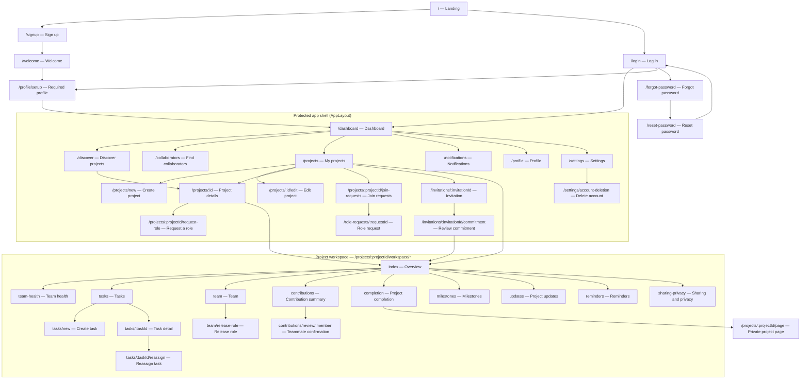

# TeamUp Frontend

**TeamUp** is a project-collaboration platform for digital-skill learners and early-career professionals. Users build a profile, discover projects or collaborators, join a team with a clear commitment, work together in a project workspace, and finish with a project page that shows what each member contributed.

Built for the TechCrush Buildathon 3.0 by Team Lattice (Group 8).

## The problem

Many people learn digital skills but struggle to find collaborators, real projects and the structure to finish. Teams often go inactive and projects get abandoned.

## Core journey

1. Sign up and create a profile (skills, goals, availability)
2. Discover projects or collaborators
3. Join a team after accepting role, hours and deadlines
4. Work in a shared workspace (tasks, milestones, progress)
5. Complete the project and generate a shareable project page with each member's contribution

## Status

MVP built for the TechCrush Buildathon 3.0. Core flows are working. A few features are still in progress, see below.

## Features

### Public and authentication

- Landing page and welcome screen
- Sign up, log in, forgot password, and reset password
- Token-based authentication with automatic session refresh
- Protected routes that redirect signed-out users to `/login`

### Onboarding and profile

- Required profile setup (skills, goals, availability, project preferences)
- Profile page with visibility controls and a public preview
- Settings for profile details, avatar upload/removal, active sessions, and account deletion

### Projects and collaboration

- Dashboard with projects that need attention and date-extension requests
- Discover open projects with filters
- Find collaborators
- My Projects list with status filters
- Create and edit projects through a multi-step wizard
- Delete a project you own
- Project details with role selection and join requests
- Owner views for join requests and role requests
- Invitations and commitment review before joining a team

### Project workspace

- Workspace overview
- Team health (falls back to demo data when the API endpoint is unavailable)
- Tasks: list, create, detail, reassign, comments, and evidence
- Team list and role release
- Milestones, project updates, reminders, and sharing/privacy settings
- Contribution summary and teammate confirmation
- Project completion flow
- Private (team-only) completed project page at `/projects/:projectId/page`

### Notifications

- Notifications list with read/unread state and an unread count badge

## Tech stack

- React 19
- Vite 8
- React Router 7
- CSS Modules
- ESLint 10 (flat config)

## Folder structure

```text
src/
  assets/        images and icons
  components/    reusable UI pieces (buttons, inputs, alerts, avatars, etc.)
  data/          shared constants and demo/mock fallback data
  hooks/         shared hooks
  layouts/       AppLayout (app shell) and AuthLayout
  pages/         one folder per screen; ProjectWorkspace holds nested screens
  services/      API client and domain services
  styles/        global CSS variables
  App.jsx        route table
  main.jsx       app entry point (BrowserRouter)
```

## Routes and navigation

All routes below the protected app shell require a token. Unauthenticated users are redirected to `/login`.



Notes:

- The top-level `/sharing-privacy` route redirects to `/projects`; workspace-level sharing/privacy settings are at `/projects/:projectId/workspace/sharing-privacy`.

## Getting started

Requirements: Node.js and npm.

```bash
git clone https://github.com/teamup-lattice/teamup-frontend.git
cd teamup-frontend
npm install
```

Create a local environment file from the example:

```bash
cp .env.example .env
```

Then set `VITE_API_URL` to the backend API base URL. The frontend expects a running TeamUp API for authentication and project data.

## Staging

https://teamup-frontend-vert.vercel.app/

Every merge to `main` deploys to staging automatically, with no manual steps.

### How it works

1. A pull request triggers the `CI` workflow (`npm ci`, lint, build). The `build` check must pass before merging.
2. After merge, Vercel builds the site (`npm run build`, output in `dist`) and publishes it.
3. If the Vercel build fails, the previous version stays live.

**Rolling back** In Vercel, open Deployments, find an earlier successful production deployment and use Instant Rollback from its menu. Then revert the bad commit on `main`.

**Environment variables** `VITE_API_URL` (backend URL) is set in Vercel under Project Settings → Environment Variables. Changing it needs a redeploy, because Vite bakes it in at build time. Never put secrets in `VITE_` variables.

**Routing** `vercel.json` rewrites all routes to `index.html` so client-side routes work on refresh.

## Environment variables

| Name           | Purpose                                            |
| -------------- | -------------------------------------------------- |
| `VITE_API_URL` | Base URL of the TeamUp backend API                 |

Do not put secrets in `VITE_` variables: Vite embeds them into the client build.

For the Vercel environment setup, see [Staging](#staging).

## Scripts

| Command           | Description                              |
| ----------------- | ---------------------------------------- |
| `npm run dev`     | Start the Vite development server        |
| `npm run build`   | Create a production build in `dist/`     |
| `npm run preview` | Preview the production build locally     |
| `npm run lint`    | Run ESLint over the project              |

## In progress

- Reminders "Request new date" and "Mark done" are not connected to the backend yet.
- Editing a member's role on the Team screen is not saved to the backend yet.
- Team health uses fallback data when its endpoint is unavailable.
- Automated tests are planned.

## Team

Frontend: Eniola, Daniel, Adetomiwa
